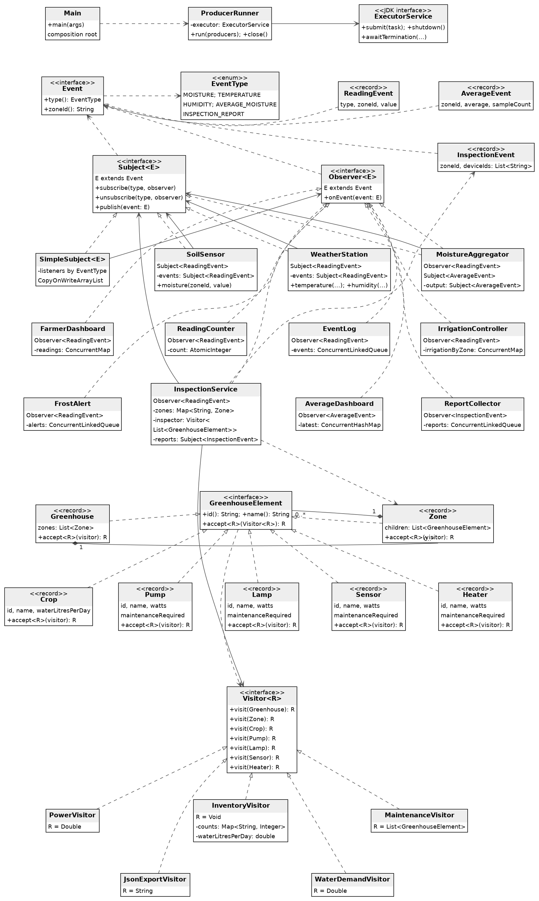

# Smart Greenhouse Assignment 6

Учебная консольная система умной теплицы для **варианта 9 — Precision agriculture**. Датчики публикуют показания, подписчики реагируют на них через **Observer**, а операции над деревом теплицы выполняются через **Visitor**. При низкой влажности система проверяет оборудование соответствующей зоны и публикует результат проверки как новое событие.

В исходном задании нет отдельного варианта с названием Smart Greenhouse. Теплица здесь является конкретной реализацией предложенной темы точного земледелия. Данные синтетические: программа не подключается к настоящим датчикам и не управляет физическим оборудованием.

## Файлы для сдачи и подготовки

- `docs/REPORT.docx` — английский отчёт по выполненной работе.
- `docs/DEFENSE_GUIDE_RU.docx` — объяснение кода, ответы и live coding на русском.
- `docs/uml.svg` — полная UML class diagram, которую можно открыть и увеличить в браузере.
- `docs/maven-test-results.txt` и `docs/demo-output-3-threads.txt` — фактические результаты проверки.

## Запуск

Нужны **JDK 17** и **Maven**. Единственная зависимость проекта — **JUnit 5.10.2**, только для тестов. В основном приложении используются исключительно классы Java Standard Library. Maven plugins отвечают за сборку, тестирование и создание JAR; runtime libraries они не добавляют.

### IntelliJ IDEA

1. Распакуйте проект в отдельную папку.
2. Выберите **File → Open** и откройте `pom.xml` как Maven project.
3. В **File → Project Structure → Project** установите **Project SDK 17** и language level **17**.
4. Дождитесь Maven sync. При первом открытии нужен интернет для загрузки JUnit и Maven plugins.
5. Откройте `src/main/java/kz/aitu/greenhouse/app/Main.java` и запустите `main()`.
6. Для тестов нажмите правой кнопкой на `src/test/java` и выберите **Run All Tests**, либо выполните Maven-команду ниже.

В терминале из папки, содержащей `pom.xml`:

```bash
java -version
mvn -version
mvn clean test package
java -jar target/smart-greenhouse-a6-1.0.0.jar
java -jar target/smart-greenhouse-a6-1.0.0.jar 4
```

`java -version` и `mvn -version` должны показывать JDK 17. По умолчанию размер thread pool равен **3**. Аргумент `4` задаёт pool размером 4; значения меньше 3 отклоняются. В demo всегда **три producer tasks**: влажность почвы, температура и влажность воздуха. Увеличение pool само по себе не добавляет четвёртый источник или задачу.

## Соответствие требованиям

| Требование Assignment 6 | Реализация |
|---|---|
| Java 17 и JUnit 5 | `pom.xml`, `maven.compiler.release=17`, test dependency `junit-jupiter` |
| Не менее двух subjects | `SoilSensor`, `WeatherStation`; дополнительные subjects для средних значений и отчётов |
| Не менее пяти listeners | Девять concrete listeners, перечисленных ниже |
| Собственные generic interfaces | `Subject<E extends Event>`, `Observer<E extends Event>` |
| Immutable typed events | Records `ReadingEvent`, `AverageEvent`, `InspectionEvent` и enum `EventType` |
| Подписки по типу, изменение подписок из callback | `SimpleSubject`, отдельный `CopyOnWriteArrayList` для каждого типа |
| Observer, одновременно являющийся Subject | `MoistureAggregator` |
| Composite минимум из трёх уровней | `Greenhouse → Zone → leaf` |
| Два container types и минимум четыре leaf types | Containers `Greenhouse`, `Zone`; leaves `Crop`, `Pump`, `Lamp`, `Sensor`, `Heater` |
| Generic Visitor и double dispatch | `Visitor<R>`, `accept()` в каждом element |
| Numeric, stateful, filter и export visitors | `PowerVisitor`, `InventoryVisitor`, `MaintenanceVisitor`, `JsonExportVisitor` |
| Новый visitor | `WaterDemandVisitor` в отдельном trade-off commit |
| Integration на связанном subtree | `InspectionService` запускает Visitor только на зоне из события |
| Минимум три producer threads | `ProducerRunner` и `Executors.newFixedThreadPool` в `Main` |
| Thread safety и graceful shutdown | Concurrent collections, atomics, короткие per-zone locks, ожидание `Future` и завершения executor |
| Composition root и constructor injection | Создание и связывание компонентов в `Main` |
| Минимум 15 JUnit tests, stress и ручные расчёты | `src/test/java`; сводка проверки ниже |
| UML и design decisions | Этот README, `docs/uml.png`, `docs/uml.mmd` |
| Два trade-off commits | Раздел истории ниже с реальными commits и изменёнными файлами |

Не используются `java.util.Observable`, event-bus libraries, Spring, reflection или примеры лекций с переименованными классами.

## Observer и движение данных

**Subject** хранит подписчиков и уведомляет их. **Observer** получает событие через `onEvent()`. Generic-параметр `E` определяет допустимый тип объекта: например, `Subject<ReadingEvent>` публикует показания, а `Subject<InspectionEvent>` — результаты проверки.

`EventType` определяет канал внутри subject: `MOISTURE`, `TEMPERATURE`, `HUMIDITY`, `AVERAGE_MOISTURE` или `INSPECTION_REPORT`. Подписка на температуру не получает события влажности. Одинаковый listener не добавляется повторно в один канал благодаря `addIfAbsent()`.

| Listener | Что делает |
|---|---|
| `FarmerDashboard` | Сохраняет последнее полученное показание отдельно для каждой зоны и типа |
| `ReadingCounter` | Считает все полученные sensor readings |
| `EventLog` | Сохраняет readings в потокобезопасной очереди |
| `IrrigationController` | Включает логическое состояние полива, когда влажность почвы меньше 30% |
| `FrostAlert` | Сохраняет предупреждение при температуре ниже 0 °C |
| `MoistureAggregator` | Вычисляет running average влажности по каждой зоне и публикует `AverageEvent` |
| `InspectionService` | При влажности меньше 30% проверяет оборудование затронутой зоны |
| `AverageDashboard` | Сохраняет агрегат с наибольшим `sampleCount` для каждой зоны |
| `ReportCollector` | Собирает опубликованные `InspectionEvent` |

Выбран **push**: subject передаёт immutable event прямо в callback. Listener получает конкретное показание и не обращается к изменяемому состоянию датчика. При **pull** listener самостоятельно запрашивал бы состояние источника; между уведомлением и чтением другой поток мог бы уже записать новое значение. Для небольшого sensor event push проще объяснить и проверить.

Пример цепочки: `SoilSensor` публикует 20% для `zone-a`; `MoistureAggregator` получает reading и публикует среднее 20% с `sampleCount=1`; `AverageDashboard` получает новое событие. Следующее значение 40% даёт среднее `(20 + 40) / 2 = 30%`.

Records не имеют setters. Для списка `InspectionEvent.deviceIds` дополнительно используется `List.copyOf()`: immutable record недостаточно, если внутри него оставить mutable список.

## Visitor и Composite

Дерево имеет три уровня и фиксированный набор типов. `Greenhouse` хранит зоны, `Zone` хранит leaves. Element records содержат данные, проверки входных значений и метод `accept()`; расчёты и экспорт находятся в visitors. Child lists копируются через `List.copyOf()`, поэтому после создания demo структура не меняется.

| Visitor | Тип результата | Операция |
|---|---|---|
| `PowerVisitor` | `Double` | Суммирует rated power оборудования в ваттах |
| `InventoryVisitor` | `Void` | Накопляет количество элементов каждого типа и водопотребление культур в собственных полях |
| `MaintenanceVisitor` | `List<GreenhouseElement>` | Возвращает только устройства с `maintenanceRequired=true` |
| `JsonExportVisitor` | `String` | Создаёт JSON с вложенными zones и children; строки экранируются вручную |
| `WaterDemandVisitor` | `Double` | Отдельно рассчитывает суточную потребность культур в воде |

Обход принадлежит **visitor**. Например, `visit(Zone)` проходит по `zone.children()` и вызывает `child.accept(this)`. Это позволяет export visitor строить вложенную структуру, а filter visitor собирать списки результатов. `accept()` сам не обходит детей, иначе элементы посещались бы дважды. Цена решения: каждый новый visitor должен реализовать обход containers.

### Как работает double dispatch

```java
GreenhouseElement element = new Pump("pump-a", "Pump A", 100, true);
Double power = element.accept(new PowerVisitor());
```

Сначала runtime выбирает `Pump.accept()`, потому что реальный объект — `Pump`. Внутри этого метода выполняется:

```java
return visitor.visit(this);
```

Здесь `this` имеет тип `Pump`, поэтому выбирается overload `visit(Pump)`. Затем вызывается реализация этого метода у конкретного visitor, в примере — `PowerVisitor`. Выбор зависит и от типа element, и от типа операции.

Прямой вызов `visitor.visit(element)` не заменяет этот механизм: compile-time тип переменной — `GreenhouseElement`, а overload `visit(GreenhouseElement)` отсутствует. Java не выбирает overload по runtime типу аргумента. Именно поэтому нужен `accept()`.

## Связь Observer и Visitor

`InspectionService` получает reading. Если событие относится к влажности почвы и значение меньше threshold, сервис находит `Zone` по `event.zoneId()` и вызывает:

```java
List<GreenhouseElement> devices = affectedZone.accept(inspector);
```

Сервис преобразует найденные devices в список IDs и публикует `InspectionEvent`. У `zone-a` в финальном demo это `pump-a`, `sensor-a`, `heater-a`. Устройство `lamp-b` также требует обслуживания, но находится в другой зоне и в этот отчёт не попадает. Это проверка именно связанного subtree, а не всей теплицы.

`MaintenanceVisitor` использует immutable данные оборудования. Низкая влажность запускает проверку, но сама по себе не изменяет `maintenanceRequired` и не доказывает поломку насоса.

## Concurrency и завершение

`SimpleSubject` заранее создаёт registry для всех event types. Итератор `CopyOnWriteArrayList` работает со snapshot подписчиков. Поэтому listener может подписать нового observer или отписаться прямо в своём callback без `ConcurrentModificationException`.

Новая подписка не появляется в уже созданном snapshot. Отписка действует на следующие snapshots, но не отменяет callback, уже захваченный другим выполняющимся publisher. Если несколько потоков публикуют одновременно, отписавшийся listener может получить ранее начатые уведомления. Эта семантика намеренная и проверяется тестами; отписка не является блокирующим ожиданием всех callback.

**Общий subject не блокируется на время уведомлений.** `ReadingCounter` использует `AtomicInteger`; журналы и отчёты — `ConcurrentLinkedQueue`; dashboards и состояние полива — concurrent maps. Для среднего значения `sum` и `count` защищены одним коротким lock конкретной зоны. Без этого можно было бы прочитать сумму одного обновления и счётчик другого. Публикация результата выполняется уже после освобождения zone lock.

Глобальный порядок событий разных producer threads не обещается. Каждый `AverageEvent` содержит согласованные average и sampleCount, а `AverageDashboard` атомарно оставляет запись с наибольшим sampleCount. `MaintenanceVisitor` stateless и безопасен для общего использования. `InventoryVisitor` stateful: он создаётся для одного отчёта и используется одним потоком после завершения producers.

`publish()` выполняет callbacks синхронно. Если один listener выбрасывает `RuntimeException`, остальные listeners всё равно получают попытку уведомления, затем исключение передаётся вызывающему коду. Ошибка не скрывается.

При нормальном выполнении `ProducerRunner` ждёт завершения всех `Future`; это включает callbacks и связанные публикации. Затем `shutdown()` запрещает новые задачи, а `awaitTermination()` ожидает остановки executor. Предоставленные конечные задачи при успешном запуске завершаются без потери событий. Timeout, interruption или ошибка producer считаются неуспешным запуском; аварийный `shutdownNow()` может отменить незавершённую работу. Для этого пути lossless delivery не заявляется.

## Clean Code и организация

`Main` — единственный production composition root: создаёт дерево, subjects, listeners и executor, передаёт зависимости в constructors и оформляет подписки. Business classes не ищут зависимости в глобальных переменных и не создают их при первом событии. Временные result lists внутри Visitor являются результатами вычислений, а не lazy dependencies.

Пакеты разделены по обязанностям: `events` описывает данные сообщений, `observer` — механизм уведомлений и источники, `listeners` — реакции, `model` — дерево, `visitor` — операции, `app` — сборку и запуск. Общая логика registry реализована один раз в `SimpleSubject`; источники используют её через delegation. GUI, база данных и REST API не нужны для требований этой работы.

## Ручные расчёты и проверка

Финальное demo содержит Heater мощностью 300 W в зоне A:

| Показатель | Ручное ожидаемое значение |
|---|---|
| Rated power зоны A | 100 + 50 + 5 + 300 = **455 W** |
| Rated power зоны B | 200 + 75 + 5 = **280 W** |
| Rated power всей теплицы | 455 + 280 = **735 W** |
| Потребность культур в воде | 10 + 20 = **30 L/day** |
| Количество nodes | 1 greenhouse + 2 zones + 9 leaves = **12** |
| Devices для обслуживания | `pump-a`, `sensor-a`, `lamp-b`, `heater-a` = **4** |
| Отчёт только по зоне A | `pump-a`, `sensor-a`, `heater-a` |
| Sensor readings | 3 moisture + 3 temperature + 3 humidity = **9** |
| Средняя влажность A и B | **30%** и **50%** |
| Frost alerts | **1**, температура −2 °C в зоне B |

В некоторых tests намеренно сохранён **baseline fixture без Heater**: он содержит **11 nodes**, **435 W** и **3 maintenance devices**. Это отдельный набор входных данных; его ожидаемые значения не нужно заменять числами финального demo. Ватты означают мощность. Энергопотребление в Wh потребовало бы дополнительно учитывать время работы.

**Проверенная сводка тестов:** 40 tests, 0 failures, 0 errors, 0 skipped; `mvn clean verify`, JDK 17.0.21.

`ObserverTest` проверяет типы событий, динамические подписки, immutable сообщения и обработку ошибок. `VisitorTest` и `JsonExportVisitorTest` проверяют ручные результаты, nesting и escaping. `IntegrationTest` проверяет выбор одной зоны. `ProducerRunnerTest` проверяет три работающих потока и завершение executor. `ConcurrencyTest` запускает **4 threads × 1 000 events**: ожидается ровно **4 000** readings у постоянных подписчиков и **4 000** агрегатов. Все значения равны 40%, поэтому итоговое среднее тоже строго ожидается 40%. Тест также проверяет отсутствие пропусков и повторов aggregate sampleCount.

## UML



Редактируемый источник диаграммы: [docs/uml.mmd](docs/uml.mmd).

## Trade off и история Git

Реальные идентификаторы двух отдельных commits: **`2b38da5` — новый visitor; `3fcc953` — новый element**.

**Добавление нового visitor `WaterDemandVisitor`.** Изменённые файлы:

- `src/main/java/kz/aitu/greenhouse/visitor/WaterDemandVisitor.java`
- `src/test/java/kz/aitu/greenhouse/visitor/WaterDemandVisitorTest.java`

В этом commit ни один element class не изменяется. Новый алгоритм описывается отдельным visitor с существующими overloads. Это преимущество Visitor, когда типы элементов стабильны, а операции регулярно добавляются.

**Добавление нового element `Heater`.** Изменённые файлы:

- `src/main/java/kz/aitu/greenhouse/app/Main.java`
- `src/main/java/kz/aitu/greenhouse/model/Heater.java`
- `src/main/java/kz/aitu/greenhouse/visitor/InventoryVisitor.java`
- `src/main/java/kz/aitu/greenhouse/visitor/JsonExportVisitor.java`
- `src/main/java/kz/aitu/greenhouse/visitor/MaintenanceVisitor.java`
- `src/main/java/kz/aitu/greenhouse/visitor/PowerVisitor.java`
- `src/main/java/kz/aitu/greenhouse/visitor/Visitor.java`
- `src/main/java/kz/aitu/greenhouse/visitor/WaterDemandVisitor.java`
- `src/test/java/kz/aitu/greenhouse/visitor/HeaterTest.java`
- `src/test/java/kz/aitu/greenhouse/visitor/VisitorTest.java`

Новый leaf требует метода `visit(Heater)` в `Visitor<R>` и соответствующей обработки во всех concrete visitors, а также test coverage. Это цена Visitor: он удобен для новых операций, но дороже при частом добавлении типов elements. Компилятор помогает найти visitors, которым не хватает нового overload.

Проверить историю и состав изменений можно командами:

```bash
git log --oneline
git show --stat <commit-id>
git show --name-only <commit-id>
```

Подготовленные commits показывают реальные этапы изменений. Требование **meaningful commit history over two weeks** нельзя выполнить одной сессией подготовки: даты не подделываются. Продолжайте фиксировать собственную подготовку, исправления и live-coding упражнения реальными commits. Уникальность варианта 9 внутри учебной группы необходимо проверить у преподавателя или группы. GitHub в рамках этой подготовки не опубликован: авторизация отсутствует. Для сдачи по условию нужны ссылка на GitHub repository и report в LMS.

## Порядок подготовки к защите

Начните с `Main`, затем проследите один `ReadingEvent` через `SoilSensor`, `SimpleSubject` и `IrrigationController`. После этого разберите `MoistureAggregator`, вызов `Pump.accept()` и один простой numeric visitor. В конце объясните integration, snapshot подписок и stress test. На защите полезно сначала показать обычный запуск, затем tests и два trade-off commits.

Нужно уметь объяснить три решения: почему отписка не отменяет уже начатый callback; почему `visitor.visit(element)` не заменяет double dispatch; почему добавление нового leaf затрагивает все visitors. Код разделён на небольшие классы именно для последовательного разбора этих решений.

## Источники

- Условие курса: `Assignment 6. Observer and Visitor Patterns.docx`, вариант 9 и общие требования.
- [Oracle Java 17 CopyOnWriteArrayList](https://docs.oracle.com/en/java/javase/17/docs/api/java.base/java/util/concurrent/CopyOnWriteArrayList.html) — snapshot iterators и thread safety списка подписчиков.
- [Oracle Java 17 ExecutorService](https://docs.oracle.com/en/java/javase/17/docs/api/java.base/java/util/concurrent/ExecutorService.html) — `submit`, `Future`, `shutdown` и `awaitTermination`.
- [JUnit 5.10.2 User Guide](https://docs.junit.org/5.10.2/user-guide/index.html) — JUnit Jupiter, assertions, timeouts и Maven integration.
